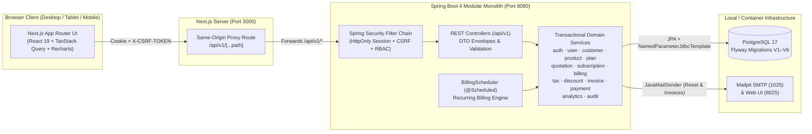
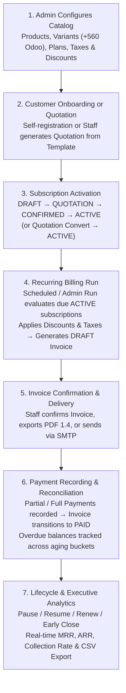

# Brightloop — Subscription Management System

**Unified subscription lifecycle, recurring billing, payment reconciliation, and financial analytics platform.**

Built for the **Odoo × Make-A-Ton 9.0 Kochi Hackathon 2026** ([Repository](https://github.com/Roshan17431/brightloop-subscription-manager)).

---

## 1. Overview

**Brightloop** is a full-stack subscription management modular monolith built with **Next.js App Router (TypeScript)**, **Java 21 / Spring Boot 4**, and **PostgreSQL 17 / Flyway**. It manages the complete lifecycle of a recurring revenue business in one system: product and variant catalog management, configurable subscription plans, reusable quotation templates, subscription lifecycle state transitions, automated recurring invoicing with tax and discount rules, partial and full payment reconciliation, overdue receivables tracking, executive MRR/ARR financial analytics, and a customer self-service portal.

---

## 2. Problem Statement

As described in the [Hackathon Problem Statement (`docs/Subscription_Management_System.pdf`)](docs/Subscription_Management_System.pdf), growing subscription businesses frequently struggle with fragmented manual workflows:

- **Customer subscriptions** are tracked across disconnected spreadsheets.
- **Renewals and expirations** depend on someone noticing dates manually.
- **Recurring invoices** are typed by hand each billing cycle, leading to missed billings or duplicate charges.
- **Taxes and promotional discounts** require manual lookup and calculation on every invoice.
- **Payments** arriving across bank transfers, UPI, cards, and cash must be reconciled manually against open invoices.
- **Executive revenue reporting** (active subscriptions, MRR, ARR, collected payments, and overdue receivables) takes days to compile at the end of each month.

---

## 3. Our Solution

Brightloop replaces manual spreadsheets with a transactional, database-enforced platform:

1. **Role-Isolated Workspaces**: Administrators configure the catalog, plans, taxes, discounts, staff accounts, and billing runs; internal staff handle day-to-day customer, quotation, subscription, invoice, and payment operations; customers sign in to a self-service portal scoped strictly to their own records.
2. **Server-Derived Financial Snapshots**: Subscription lines, quotations, and invoices snapshot unit prices (`salesPrice + variantAdjustment`), discount amounts, and tax rates using `BigDecimal(19,2)` arithmetic so future catalog edits never corrupt historical financial records.
3. **Idempotent Recurring Billing**: Scheduled and on-demand billing runs evaluate due `ACTIVE` subscriptions across `DAILY`, `WEEKLY`, `MONTHLY`, and `YEARLY` cycles, preserve end-of-month and leap-year anchors, apply eligible discounts and tax rules automatically, and prevent duplicate invoices via database constraints (`UNIQUE (subscription_id, billing_period_start)` and `idempotency_key`) and pessimistic row locks (`SELECT ... FOR UPDATE`).
4. **Ledger-Backed Payment Reconciliation**: Staff record partial or full payments against confirmed invoices, automatically updating `amountPaid`, `outstandingAmount`, and invoice state (`CONFIRMED → PAID`), with support for non-destructive payment reversals and overdue follow-up notes.
5. **Sub-Second PostgreSQL Financial Analytics**: Real-time SQL aggregations compute normalized pre-tax MRR, ARR, invoiced vs. collected revenue trends, payment method share, 4-bucket overdue receivables aging (`1–30`, `31–60`, `61–90`, `90+` days), and RFC-compliant CSV exports—verified under 3,000+ subscriptions well below the 2-second target SLA.

---

## 4. Key Features

| Domain | Implemented Capabilities |
| :--- | :--- |
| **Identity & Access Control** | Customer registration with strong password validation, BCrypt hashing, server-side `HttpOnly` JDBC sessions, CSRF protection, SMTP password reset links (hashed, expiring, single-use tokens), and strict `ADMIN`, `STAFF`, and `CUSTOMER` RBAC. |
| **Customers, Products & Plans** | Linked and staff-managed customer profiles; products with signed variant price adjustments (e.g., `+560.00` for Odoo brand) and cost-price redaction for customers; plans with `DAILY`, `WEEKLY`, `MONTHLY`, and `YEARLY` billing periods, minimum quantities, availability windows, and policy flags (`automaticClosing`, `earlyClosingAllowed`, `pausingAllowed`, `renewalAllowed`). |
| **Quotations & Templates** | Reusable quotation templates with plan and product line defaults; customer quotation generation, expiry tracking, confirmation, and one-click transactional conversion into an `ACTIVE` subscription preserving agreed price snapshots. |
| **Subscription Lifecycle** | Sequential state transitions (`DRAFT → QUOTATION → CONFIRMED → ACTIVE → CLOSED`) plus `PAUSED` state; plan-governed pause, resume (shifting `nextBillingDate` and `expiryDate` by paused duration), idempotent renewal, and early closing with audit trails. |
| **Recurring Billing & Invoicing** | Scheduled daily cron and admin-triggered billing runs; automatic tax rule resolution (product, product-type, default) and discount application (percentage/fixed, usage limits, thresholds); `DRAFT`, `CONFIRMED`, `PAID`, and `CANCELLED` invoice states; binary PDF 1.4 export, print layout, and SMTP email delivery. |
| **Payments & Receivables** | Partial and full payment recording (`BANK_TRANSFER`, `UPI`, `CARD`, `CASH`, `OTHER`), automatic invoice reconciliation, zero-value (`100%` discount) invoice settlement, payment reversals, overdue days calculation, and collection follow-up logging. |
| **Executive Analytics & Portal** | 12 KPI cards (MRR, ARR, paused MRR, invoiced, collected, outstanding, overdue), 6 Recharts visualizations, 4-bucket overdue aging schedule, multi-dimensional filters, CSV report export, and customer self-service portal. |

For a complete phase-by-phase breakdown, see [Implemented Features (`docs/features.md`)](docs/features.md).

---

## 5. Application Screenshots

All screenshots below are captured from the running local application backed by PostgreSQL 17:

### Executive Financial Analytics Dashboard


### Revenue, Collection & MRR Charts


### Product Variant Pricing & Plan Policy Configuration


### Subscription Lifecycle, Pause, Resume & Renewal


### Automated Recurring Invoice with Tax & Discount Snapshots


### Partial & Full Payment Reconciliation


### Customer Self-Service Subscription & Quotation Conversion


---

## 6. Technology Stack

| Layer | Technology | Version / Details |
| :--- | :--- | :--- |
| **Frontend** | Next.js (App Router), React, TypeScript | Next.js `16.4.3`, React `19.3.1`, TypeScript `5.9.3` |
| **UI & Styling** | Tailwind CSS, shadcn/ui (Radix primitives), Lucide Icons | Tailwind CSS `4.3.3`, Recharts `3.3.0`, Sonner `2.0.7` |
| **State & Forms** | TanStack Query, React Hook Form, Zod | TanStack Query `5.90.0`, RHF `7.65.0`, Zod `4.1.0` |
| **Backend** | Java, Spring Boot (Web MVC, Security, Validation, Actuator, Mail) | Java `21`, Spring Boot `4.0.9`, Spring Session JDBC |
| **Persistence** | Spring Data JPA / Hibernate, NamedParameterJdbcTemplate, Flyway | PostgreSQL `17`, Hibernate `7.2`, Flyway `V1`–`V6` SQL migrations |
| **Infrastructure** | Docker Compose, Mailpit SMTP/HTTP, GitHub Actions CI | `postgres:17-alpine`, `axllent/mailpit` |
| **Testing & QA** | JUnit 5, Vitest, Testing Library, Playwright CLI, k6, Python HTTP runner | JUnit Jupiter `5.14.4`, Vitest `4.0.18` |

---

## 7. System Architecture

Brightloop follows a **modular monolith** architecture on the backend (`com.brightloop.modules.*`) paired with a **feature-based Next.js App Router** frontend (`frontend/src/features/*`). All browser requests use a same-origin `/api/v1` proxy route to preserve `HttpOnly` session cookies and CSRF tokens without cross-origin credential exposure.



For detailed module boundaries, database ER diagrams, and design trade-offs, see [Architecture Documentation (`docs/architecture.md`)](docs/architecture.md).

---

## 8. End-to-End Business Workflow



---

## 9. Installation Prerequisites

Ensure the following tools are installed on your development machine (macOS / Linux):

- **Java 21** (OpenJDK 21)
- **Maven** `3.9+`
- **Node.js** `22 LTS` and **npm**
- **Docker Desktop** (with Docker Compose v2) for PostgreSQL 17 and Mailpit

Verify your local toolchain on macOS:

```sh
brew install openjdk@21 maven
export JAVA_HOME="$(brew --prefix openjdk@21)/libexec/openjdk.jdk/Contents/Home"
export PATH="$JAVA_HOME/bin:$PATH"
java -version
mvn -version
node --version
docker compose version
```

---

## 10. Local Setup & Environment Configuration

Never commit `.env` files or secrets. Copy the provided `.env.example` templates and supply your own local values:

### Step 1: Configure Infrastructure (`infrastructure/.env`)

```sh
cp -n infrastructure/.env.example infrastructure/.env
```

Edit `infrastructure/.env` and set a local `POSTGRES_PASSWORD`:

| Variable | Example / Default | Purpose |
| :--- | :--- | :--- |
| `POSTGRES_DB` | `brightloop` | PostgreSQL database name |
| `POSTGRES_USER` | `brightloop` | PostgreSQL database user |
| `POSTGRES_PASSWORD` | *(your local password)* | Required by `infrastructure/compose.yaml` |
| `POSTGRES_PORT` | `5432` | Host loopback port mapped to container `5432` |
| `MAILPIT_SMTP_PORT` | `1025` | Host loopback port for SMTP capture |
| `MAILPIT_HTTP_PORT` | `8025` | Host loopback port for Mailpit web UI |

### Step 2: Configure Backend (`backend/.env`)

```sh
cp -n backend/.env.example backend/.env
```

Edit `backend/.env` so `DB_URL`, `DB_USERNAME`, and `DB_PASSWORD` match your PostgreSQL instance, and set `ADMIN_EMAIL` and `ADMIN_PASSWORD` (must be >8 chars with uppercase, lowercase, and special character) to bootstrap the initial administrator account on startup:

| Variable | Example / Default | Purpose |
| :--- | :--- | :--- |
| `DB_URL` | `jdbc:postgresql://localhost:5432/brightloop` | JDBC connection URL |
| `DB_USERNAME` | `brightloop` | Database username |
| `DB_PASSWORD` | *(matches `POSTGRES_PASSWORD`)* | Database password |
| `PORT` | `8080` | Spring Boot HTTP port |
| `FRONTEND_URL` | `http://localhost:3000` | Allowed CORS origin & password-reset link base URL |
| `COOKIE_SECURE` | `false` | Set `true` behind HTTPS in production |
| `ADMIN_EMAIL` | `admin@brightloop.local` | Optional initial admin bootstrap email |
| `ADMIN_PASSWORD` | *(strong password)* | Optional initial admin bootstrap password |
| `ADMIN_NAME` | `'Brightloop Administrator'` | Display name for bootstrapped admin |
| `SMTP_HOST` / `SMTP_PORT` | `localhost` / `1025` | SMTP server for password reset & invoice emails |
| `MAIL_FROM` | `no-reply@brightloop.local` | Sender address for outbound emails |

### Step 3: Configure Frontend (`frontend/.env.local`)

```sh
cp -n frontend/.env.example frontend/.env.local
```

| Variable | Example / Default | Purpose |
| :--- | :--- | :--- |
| `BACKEND_URL` | `http://localhost:8080` | Upstream Spring Boot URL used by Next.js `/api/v1` proxy |
| `NEXT_PUBLIC_API_URL` | *(leave unset for same-origin `/api/v1`)* | Optional override if calling backend directly |

---

## 11. Running the Application

### 1. Start PostgreSQL and Mailpit

```sh
docker compose --env-file infrastructure/.env up -d
docker compose --env-file infrastructure/.env ps
```

### 2. Start the Spring Boot Backend (Terminal 1)

Flyway automatically applies migrations `V1`–`V6` on startup, and Hibernate validates the schema (`ddl-auto: validate`):

```sh
export JAVA_HOME="$(brew --prefix openjdk@21)/libexec/openjdk.jdk/Contents/Home"
export PATH="$JAVA_HOME/bin:$PATH"
cd backend
set -a
source .env
set +a
mvn spring-boot:run
```

*(Optional)* Load credential-free sample products and plans into a disposable development database after Flyway completes:

```sh
docker compose --env-file infrastructure/.env exec -T postgres sh -c 'psql -v ON_ERROR_STOP=1 -U "$POSTGRES_USER" -d "$POSTGRES_DB"' < infrastructure/seed-development.sql
```

### 3. Start the Next.js Frontend (Terminal 2)

```sh
cd frontend
npm ci
npm run dev
```

### Local Endpoints

- **Web Application**: `http://localhost:3000`
- **Backend API & Health**: `http://localhost:8080/api/v1` and `http://localhost:8080/actuator/health`
- **Mailpit Web UI (Reset & Invoice Emails)**: `http://localhost:8025`

For detailed setup, migration, and troubleshooting instructions, see [Setup and Deployment Guide (`docs/setup-and-deployment.md`)](docs/setup-and-deployment.md).

---

## 12. User Roles and Permissions

Authorization is enforced both in the Spring Security filter chain / domain services and in the role-aware frontend navigation shell:

| Capability | `ADMIN` | `STAFF` | `CUSTOMER` |
| :--- | :---: | :---: | :---: |
| Create staff accounts & change user roles (`/api/v1/staff`, `/api/v1/users`) | Yes | No (`403`) | No (`403`) |
| Create, update, or delete Products, Variants, Plans, Tax Rules & Discounts | Yes | Read-only (`403` on writes) | Catalog read-only (cost prices redacted; `403` on tax/discount rules) |
| Trigger manual recurring billing runs & retries (`/api/v1/billing/run`) | Yes | Read due/history (`403` on trigger) | No (`403`) |
| Manage Customers, Quotation Templates & Quotations | Yes | Yes | Own profile & own quotations only |
| Manage Subscriptions & Lifecycle (`pause`, `resume`, `renew`, `close`) | All subscriptions | All subscriptions | Own subscriptions only (when plan policy allows) |
| Confirm/Cancel/Email Invoices & Record/Reverse Payments | All records | All records | Read own invoices & payments; download own invoice PDFs |
| Executive Financial Analytics & CSV Export (`/api/v1/analytics/**`) | Yes | Yes | No (`403`; uses `/api/v1/portal/overview`) |

---

## 13. API Documentation

All REST endpoints are versioned under `/api/v1` and return standardized JSON envelopes (`{success, statusCode, status, message, data, timestamp}` on success; `{success: false, statusCode, status, message, errorCode, path, timestamp, details}` on error).

See the complete [API Reference (`docs/api.md`)](docs/api.md) for endpoint tables, query parameters, request/response schemas, and CSRF session flow.

---

## 14. Testing and Verification

### Automated Test Suites

| Suite | Command | Verified Result |
| :--- | :--- | :--- |
| **Backend Unit & PostgreSQL Integration Tests** | `cd backend && mvn verify` | **44 tests passed** (`0` failures, `0` errors, `0` skips) on PostgreSQL 17.11 + Mailpit (48 tests including local query-date binding suite) |
| **Frontend TypeScript Check** | `cd frontend && npm run typecheck` | **Passed** (`tsc --noEmit` with 0 errors) |
| **Frontend Component & Unit Tests** | `cd frontend && npm test` | **9 test files / 48 tests passed** (Vitest + Testing Library) |
| **Frontend Production Build** | `cd frontend && npm run build` | **Passed** (Next.js production build) |
| **Packaged HTTP Smoke Suite** | `python3 infrastructure/smoke-test.py` | **760 HTTP assertions passed** against packaged Spring Boot JAR |
| **Playwright CLI Browser QA & Demo Capture** | See `demo/README.md` & `docs/testing-and-quality.md` | **42/42 auth & RBAC browser checks passed**; 8-chapter end-to-end workflow verified |

### Current GitHub Actions CI Status

- **Backend CI Job (`ubuntu-latest` + `postgres:17-alpine` + `axllent/mailpit:v1.22`)**: **Passing** in remote GitHub Actions (`mvn -B verify` succeeded across all 44 tests).
- **Frontend CI Job**: Locally passes all 48 Vitest tests, `npm run typecheck`, and `npm run build`. In the latest remote GitHub Actions run (`41180459763` on `Phase-1`), `.github/workflows/ci.yml` sets `NEXT_PUBLIC_API_URL: http://localhost:8080`, which causes `src/lib/api.test.ts` (asserting the default same-origin proxy path `/api/v1/auth/csrf`) to receive `http://localhost:8080/auth/csrf`. Remote CI is therefore reported as **partially failing on that environment variable mismatch** until `.github/workflows/ci.yml` omits `NEXT_PUBLIC_API_URL` (or sets it to `/api/v1`) and is re-run remotely.

See the full [Testing and Quality Report (`docs/testing-and-quality.md`)](docs/testing-and-quality.md).

---

## 15. Performance Benchmarks

The hackathon problem statement requires pages to respond in **under 2,000 ms (2 seconds)** with thousands of subscriptions on the books. In `Phase5SecurityFinancialPerformanceIntegrationTest`, Brightloop was benchmarked against **PostgreSQL 17.11** populated with **3,000+ subscriptions, 3,000+ subscription lines, 3,000+ invoices, and 2,000+ payments**:

| Endpoint / Scenario | p50 Latency | p95 Latency | p99 Latency | Throughput (req/s) | Errors |
| :--- | ---: | ---: | ---: | ---: | ---: |
| `GET /api/v1/analytics/overview` | 35.56 ms | 51.34 ms | 51.34 ms | 27.1 req/s | 0 |
| `GET /api/v1/analytics/revenue` | 5.32 ms | 6.09 ms | 6.09 ms | 186.3 req/s | 0 |
| `GET /api/v1/analytics/subscriptions` | 24.26 ms | 34.33 ms | 34.33 ms | 39.8 req/s | 0 |
| `GET /api/v1/analytics/payments` | 3.18 ms | 4.01 ms | 4.01 ms | 300.6 req/s | 0 |
| `GET /api/v1/analytics/receivables` | 3.35 ms | 4.27 ms | 4.27 ms | 291.7 req/s | 0 |
| `GET /api/v1/analytics/renewals` | 9.79 ms | 10.31 ms | 10.31 ms | 102.4 req/s | 0 |
| `GET /api/v1/analytics/reports/export` | 2.77 ms | 3.64 ms | 3.64 ms | 356.7 req/s | 0 |
| `GET /api/v1/subscriptions?page=0&size=20` | 6.66 ms | 7.75 ms | 7.75 ms | 149.5 req/s | 0 |
| `GET /api/v1/invoices?page=0&size=20&overdue=true` | 15.19 ms | 16.69 ms | 16.69 ms | 72.8 req/s | 0 |
| `GET /api/v1/payments?page=0&size=20` | 5.76 ms | 6.96 ms | 6.96 ms | 174.2 req/s | 0 |
| **Concurrent 20 VUs** `GET /api/v1/analytics/overview` | 207.36 ms | 378.23 ms | 454.75 ms | 80.6 req/s | 0 |

An external k6 load script is also provided at [`infrastructure/k6-load-test.js`](infrastructure/k6-load-test.js).

---

## 16. Security Highlights

- **Session & Cookie Security**: Server-side sessions stored in PostgreSQL (`SPRING_SESSION`) with `HttpOnly`, `SameSite=Lax` cookies; session IDs rotate upon authentication (`changeSessionId()`) and all active sessions for a user are revoked upon password reset.
- **CSRF & Security Headers**: `HttpSessionCsrfTokenRepository` required on all state-mutating requests (`POST`, `PUT`, `PATCH`, `DELETE`), paired with `X-Content-Type-Options: nosniff`, `X-Frame-Options: DENY`, `Referrer-Policy: strict-origin-when-cross-origin`, and `Permissions-Policy: camera=(), microphone=(), geolocation=()`.
- **IDOR & Ownership Isolation**: Every customer-accessible service method (`CustomerService`, `SubscriptionService`, `QuotationService`, `InvoiceService`, `PaymentService`, `AnalyticsService`) scopes queries and mutations to the authenticated customer's linked `customerId`. Internal product cost prices and internal tax/discount rule lists are restricted to `STAFF`/`ADMIN`.
- **Financial & Concurrency Locks**: Pessimistic row-level locking (`LockModeType.PESSIMISTIC_WRITE`) and optimistic `@Version` columns serialize concurrent recurring billing runs, single-use discount redemptions, and concurrent payment recordings.
- **Injection & Export Hardening**: Parameterized JPA/JDBC queries, SQL `LIKE` wildcard escaping (`\`, `%`, `_`), and spreadsheet formula injection neutralization (`=`, `+`, `-`, `@`, `\t`, `\r` prefixed and quoted in CSV exports).

---

## 17. Demo Video & Walkthrough

A complete 4-minute 51-second (`291.07s`, `1600×1000` @ `30fps` H.264) Playwright browser demonstration recording of the live application is available locally at:

- **Video File**: [`demo/brightloop-hackathon-demo.mp4`](demo/brightloop-hackathon-demo.mp4)
- **Demo Documentation & Verification**: [`demo/README.md`](demo/README.md) and [`docs/demo-and-submission.md`](docs/demo-and-submission.md)
- **Optional Narration Script**: [`demo/narration.md`](demo/narration.md)

*(Note: The MP4 file is generated and verified locally; external video hosting links should be added at submission time.)*

---

## 18. Known Limitations

1. **Ledger-Based Payment Recording**: Payment recording (`BANK_TRANSFER`, `UPI`, `CARD`, `CASH`, `OTHER`) performs internal invoice reconciliation and audit logging; it does not integrate with live external payment gateway webhooks (e.g., Stripe or Razorpay).
2. **Customer Portal `/overview` Subscription Array**: During visual QA of the demo fixture, `GET /api/v1/portal/overview` returned accurate active subscription counts and balances (`activeCount: 2`), while its inline `subscriptions` preview array and `nextBillingDate` summary field returned empty/`null` for that fixture; the customer's `/subscriptions`, `/subscriptions/{id}`, `/invoices`, and `/payments` pages work as expected.
3. **Remote CI Frontend Env Variable**: As noted in Section 14, `.github/workflows/ci.yml` currently sets `NEXT_PUBLIC_API_URL: http://localhost:8080` in the `frontend` job, which conflicts with the unit test assertion in `frontend/src/lib/api.test.ts` expecting the default `/api/v1/auth/csrf` proxy path.
4. **Local Verification Scope**: All functional, security, and 3,000-subscription performance benchmarks were executed on local developer infrastructure (macOS + PostgreSQL 17.11 + Mailpit), not on a cloud production cluster.

---

## 19. Documentation Index

- **[Documentation Hub (`docs/README.md`)](docs/README.md)** — Central index of all project documentation
- **[Implemented Features (`docs/features.md`)](docs/features.md)** — Complete Phase 1–5 functional catalog
- **[System Architecture (`docs/architecture.md`)](docs/architecture.md)** — Modular monolith design, Mermaid diagrams, and trade-offs
- **[REST API Reference (`docs/api.md`)](docs/api.md)** — Full `/api/v1` endpoint specification
- **[Setup & Deployment Guide (`docs/setup-and-deployment.md`)](docs/setup-and-deployment.md)** — Step-by-step local setup, environment variables, and troubleshooting
- **[Testing & Quality Report (`docs/testing-and-quality.md`)](docs/testing-and-quality.md)** — Test suites, 3,000+ subscription benchmarks, security audit, and CI status
- **[Demo & Submission Guide (`docs/demo-and-submission.md`)](docs/demo-and-submission.md)** — Judge walkthrough script and submission checklist
- **[Implementation Status Ledger (`docs/implementation-status.md`)](docs/implementation-status.md)** — Chronological phase-by-phase engineering log

---

## 20. Team Contributions & Hackathon Acknowledgement

Developed for the **Odoo × Make-A-Ton 9.0 Kochi Hackathon 2026** by the Brightloop engineering team ([`Roshan17431/brightloop-subscription-manager`](https://github.com/Roshan17431/brightloop-subscription-manager)):

- **Phase 1 — Foundation & Core Modules**: Authentication, RBAC, customers, products/variants, plans, draft-to-closed subscription lifecycle, Flyway V1–V3, and HTTP smoke test suite.
- **Phase 2 — Recurring Billing, Invoicing, Taxes & Discounts**: Scheduled/manual billing engine, end-of-month/leap-year schedule advancement, tax and discount rules, PDF 1.4 generation, SMTP invoice delivery, and Flyway V4.
- **Phase 3 — Payments, Lifecycle Extensions & Quotations**: Partial/full payment reconciliation, reversals, overdue tracking, subscription pause/resume/renew/early-close, quotation templates and conversion, and Flyway V5.
- **Phase 4 — Executive Analytics & Customer Self-Service Portal**: Normalized MRR/ARR engine, revenue/payment/receivables aging SQL aggregations, Recharts dashboards, CSV export, customer portal, and Flyway V6.
- **Phase 5 & 6 — Security Hardening, Performance Benchmarking, Demo & Documentation**: RBAC/IDOR hardening, CSV formula neutralization, 3,000+ subscription performance benchmark, Playwright browser QA & 8-chapter demo recording, and comprehensive submission documentation.

We thank the **Odoo** and **Make-A-Ton 9.0 Kochi** organizers and mentors for crafting a practical, real-world software engineering problem statement.
