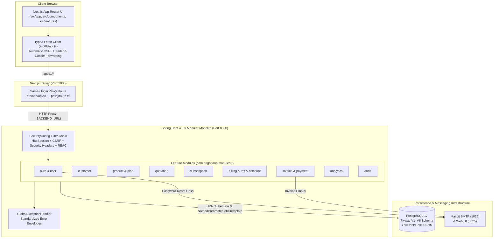
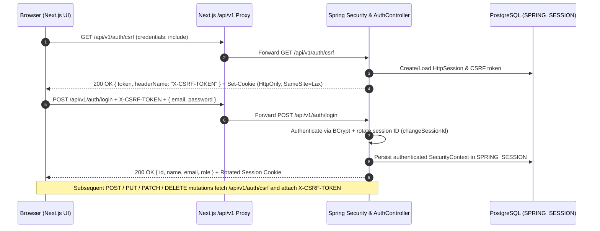
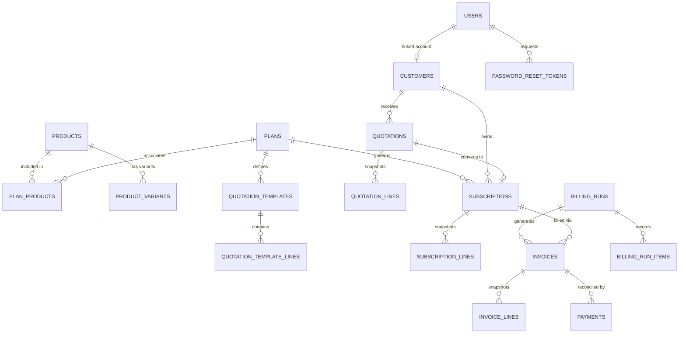
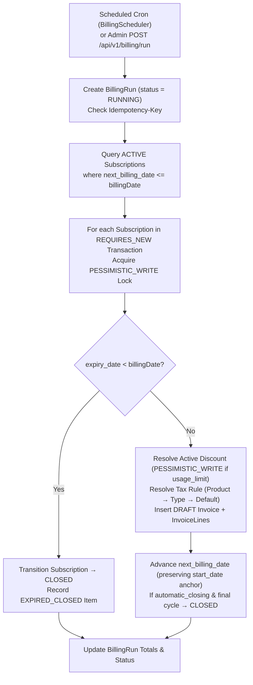

# Brightloop — System Architecture

Brightloop is designed as a **Spring Boot 4 modular monolith** (`backend/`) paired with a **feature-based Next.js App Router** frontend (`frontend/`) and backed by **PostgreSQL 17** with versioned **Flyway SQL migrations** (`V1`–`V6`).

---

## 1. High-Level Architecture & Request Flow

---

## 2. Modular Monolith Package Organization

### Backend (`backend/src/main/java/com/brightloop`)

- **Shared Infrastructure**:
  - `config/`: `SecurityConfig` (session, CSRF, headers, endpoint authorization), `AdminBootstrap` (idempotent startup admin creation from env), `AccountStatus`, `RecordEntity` (base `@MappedSuperclass` with `createdAt`/`updatedAt`).
  - `security/`: `CurrentUser` (resolves authenticated principal, role assertions `requireAdmin()`, `requireManager()`, customer ownership resolution), `SessionRevoker`.
  - `response/`: `ApiResponse<T>` (standardized success envelope) and `PageResponse<T>` (bounded pagination 1–100 and escaped SQL `LIKE` search helper).
  - `exception/`: `ApiException`, `ApiError`, and `GlobalExceptionHandler` (`@RestControllerAdvice` translating validation, conflict, security, and unexpected exceptions without leaking stack traces).
  - `validation/`: `Rules` (pure domain rule validations for passwords, monetary precision, date ranges, sequential state transitions, and date-anchored billing schedule advancement).
- **Feature Modules (`com.brightloop.modules.*`)**:
  - `auth`: Session login/logout, CSRF token endpoint, forgot/reset password with SHA-256 hashed single-use expiring tokens.
  - `user`: User entity, roles (`ADMIN`, `STAFF`, `CUSTOMER`), admin-only staff creation and role updates.
  - `customer`: Customer profiles, linked user accounts, self-service `/customers/me` endpoint.
  - `product`: Products and `product_variants` with signed `BigDecimal` price adjustments and customer cost-price redaction.
  - `plan`: Subscription plans, billing frequencies (`DAILY`, `WEEKLY`, `MONTHLY`, `YEARLY`), availability windows, minimum quantities, policy flags, and `plan_products` associations.
  - `quotation`: Reusable `quotation_templates` and customer `quotations` with confirmation, expiry, and transactional conversion into active subscriptions.
  - `subscription`: Numbered subscriptions (`BL-...`), snapshotted `subscription_lines`, sequential transitions (`DRAFT → QUOTATION → CONFIRMED → ACTIVE → CLOSED`), and `pause` / `resume` / `renew` / `early-close` lifecycle operations.
  - `tax` & `discount`: Admin-managed tax rules (product, product-type, default) and discount rules (`PERCENTAGE`, `FIXED`, usage limits, minimum quantity/purchase thresholds).
  - `billing`: Scheduled (`BillingScheduler`) and manual (`BillingService`) recurring billing engine, `billing_runs`, and `billing_run_items`.
  - `invoice`: Invoices (`INV-...`), snapshotted `invoice_lines`, self-contained PDF 1.4 generator (`InvoicePdfGenerator`), SMTP email delivery, zero-invoice settlement, and overdue follow-up logging.
  - `payment`: Partial and full payment recording, invoice reconciliation, and non-destructive payment reversals.
  - `analytics`: Executive financial analytics (`overview`, `revenue`, `subscriptions`, `payments`, `receivables`, `renewals`, CSV export) and customer portal summary (`/portal/overview`).
  - `audit`: Transactional mutation logging into `audit_logs`.

### Frontend (`frontend/src`)

- `app/api/v1/[...path]/route.ts`: Same-origin Next.js Route Handler proxying `/api/v1/*` and `/actuator/health` to `BACKEND_URL`, forwarding `Cookie`, `Set-Cookie`, `X-CSRF-TOKEN`, `Idempotency-Key`, and binary PDF/CSV streams.
- `app/[[...path]]/page.tsx`: Catch-all route dispatcher mapping clean paths (`/dashboard`, `/customers`, `/products`, `/plans`, `/subscriptions`, `/quotations`, `/invoices`, `/payments`, `/billing`, `/taxes`, `/discounts`, `/reports`, `/team`, `/profile`) to role-appropriate feature views.
- `components/`: `shell.tsx` (responsive sidebar/drawer layout and role-filtered navigation), `shared.tsx` (reusable tables, badges, pagination, dialogs, currency formatters), and `ui/` (shadcn/ui primitives).
- `features/`: `auth`, `dashboard`, `analytics`, `customers`, `catalog`, `subscriptions`, `quotations`, `billing`, `payments`, `users`.
- `lib/`: `api.ts` (typed fetch wrapper with automatic pre-mutation CSRF token retrieval) and `types.ts` (strict TypeScript DTO interfaces where all monetary values remain exact decimal strings).

---

## 3. Authentication, Session & CSRF Flow

---

## 4. Database Persistence & Flyway Migration Strategy

Hibernate is configured with `spring.jpa.hibernate.ddl-auto: validate`. Every schema change is authored in versioned Flyway SQL migrations under `backend/src/main/resources/db/migration/`:

| Migration | Scope & Key Schema Elements |
| :--- | :--- |
| `V1__foundation.sql` | Core tables (`users`, `customers`, `products`, `product_variants`, `plans`, `plan_products`, `subscriptions`, `subscription_lines`, `password_reset_tokens`, `audit_logs`, `SPRING_SESSION`, `SPRING_SESSION_ATTRIBUTES`) with FK, `CHECK`, and `UNIQUE` constraints. |
| `V2__session_principal_email_length.sql` | Expands `SPRING_SESSION.principal_name` to `VARCHAR(254)` to support RFC-compliant email lengths. |
| `V3__subscription_plan_index.sql` | Adds index `idx_subscriptions_plan` on `subscriptions(plan_id)` for fast foreign-key checks and joins. |
| `V4__billing_invoicing_taxes_discounts.sql` | Adds `next_billing_date`/`last_billed_date` to `subscriptions`; creates `tax_rules`, `discounts`, `billing_runs`, `billing_run_items`, `invoices`, and `invoice_lines`; enforces `uq_invoices_subscription_period` (`UNIQUE (subscription_id, billing_period_start)`) and `CHECK (state <> 'PAID' OR (payment_reference IS NOT NULL AND paid_at IS NOT NULL))`. |
| `V5__payments_quotations_lifecycle.sql` | Adds `PAUSED` subscription state and pause/resume/renew/close columns; adds `amount_paid` and `chk_invoices_paid_reconciled` (`state <> 'PAID' OR amount_paid = total`) to `invoices`; creates `payments`, `quotation_templates`, `quotation_template_lines`, `quotations`, and `quotation_lines`. |
| `V6__analytics_indexes.sql` | Adds composite analytics indexes on `invoices`, `payments`, `subscriptions`, and `subscription_lines` to keep executive dashboard and reporting queries under 55ms at 3,000+ subscriptions. |

### Core Entity-Relationship Diagram

---

## 5. Recurring Billing, Transaction Isolation & Payment Reconciliation

### Key Financial & Concurrency Safeguards

1. **Per-Subscription Transaction Isolation (`Propagation.REQUIRES_NEW`)**: During a batch billing run, each subscription is evaluated inside its own independent transaction (`BillingSubscriptionProcessor`). If one subscription encounters a fault, only that subscription's invoice creation and discount usage increment roll back, while the failure is logged in `billing_run_items` for later retry (`POST /api/v1/billing/runs/{id}/retry`).
2. **Duplicate Invoice Prevention**: Enforced at three layers:
   - Service check before invoice generation.
   - Pessimistic row lock (`SELECT ... FOR UPDATE`) on the `subscriptions` row.
   - PostgreSQL unique constraint `uq_invoices_subscription_period` on `(subscription_id, billing_period_start)` and `UNIQUE (idempotency_key)`.
3. **Payment Reconciliation Locking**: Recording or reversing a payment acquires a `PESSIMISTIC_WRITE` lock on the target `Invoice` entity, recalculates `amountPaid` from completed payments, verifies `0 <= amount_paid <= total` (also enforced by PostgreSQL `chk_invoices_amount_paid_bounds` and `chk_invoices_paid_reconciled`), and transitions `CONFIRMED ↔ PAID` atomically.

---

## 6. Key Design Decisions & Trade-Offs

- **Modular Monolith vs. Microservices**: Keeping all domain modules inside one Spring Boot deployment allows strict ACID transactions across subscriptions, invoices, discounts, payments, and audit logs without distributed two-phase commits or eventual-consistency drift.
- **String-Serialized `BigDecimal` Money Contract**: All monetary columns use `NUMERIC(19,2)` (or `NUMERIC(14,2)` for unit prices) in PostgreSQL, `BigDecimal` with `RoundingMode.HALF_UP` in Java, and string serialization in JSON DTOs so browser JavaScript never introduces IEEE-754 floating-point rounding errors.
- **Direct `SpringApplication` Integration Tests on JUnit 5.14.4**: Spring Boot 4.0.9 / Spring Framework 7's `SpringExtension` targets JUnit 6, while the project pins JUnit Jupiter `5.14.4`. Integration tests launch a real `SpringApplication` (`NativeSpringApplication`) on an ephemeral port against live PostgreSQL 17 and Mailpit, testing the complete HTTP servlet filter chain end-to-end without mocks or in-memory H2 substitutes.
